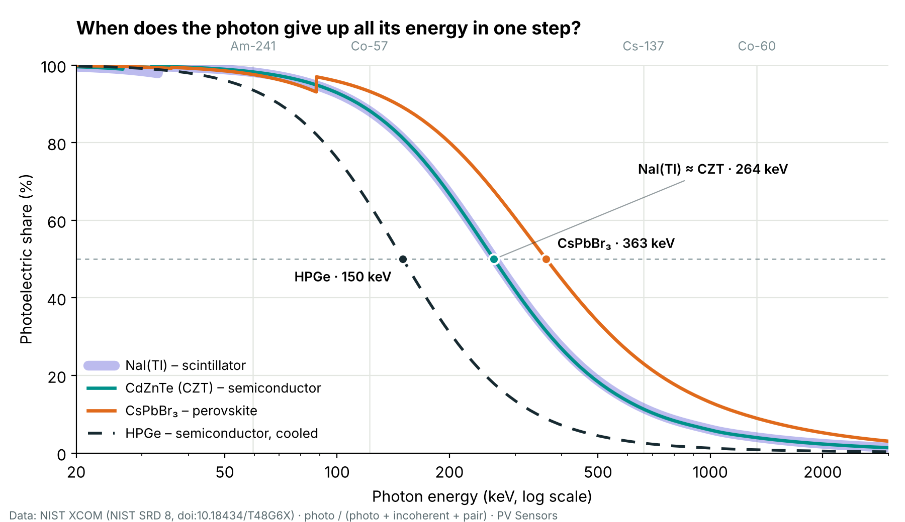
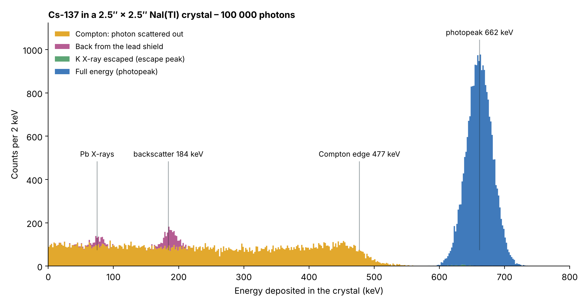

# How a gamma-ray detector works – notebooks (NIST XCOM + Monte-Carlo)

Two Jupyter notebooks behind the figures of the PV Sensors article
[*How a gamma-ray detector works – from one photon to becquerels*](https://pvsensors.com/blog/detectors/how-a-gamma-ray-detector-works).

| Notebook | What it does |
|---|---|
| [`figure1_photoelectric_share.ipynb`](figure1_photoelectric_share.ipynb) | **Figure 1** – which share of the interactions is photoelectric, versus energy, for NaI(Tl), CZT, CsPbBr₃ and HPGe, from NIST XCOM. Explains how to download XCOM data by hand or with code. |
| [`figure2_monte_carlo_spectra.ipynb`](figure2_monte_carlo_spectra.ipynb) | **Figure 2** – Monte-Carlo spectrum of ¹³⁷Cs in a 2.5″ × 2.5″ NaI(Tl) crystal, then the same for **any crystal** (13 direct and indirect detectors), **any size** and **any source** (Am-241, Co-57, Ba-133, Cs-137, Na-22, Co-60, K-40, Tl-208 or your own lines), plus full-energy-peak efficiency versus energy. |




## Run

```bash
git clone https://github.com/PVSensors/how-a-gamma-ray-detector-works.git
cd how-a-gamma-ray-detector-works
python -m venv .venv && source .venv/bin/activate   # Windows: .venv\Scripts\activate
pip install -r requirements.txt
jupyter lab
```
Open a notebook and choose **Run → Run All Cells**. Everything runs offline with the cached XCOM tables.

## What you can change in the Monte-Carlo (`pvmc.py`)

| Where | Parameter | Meaning |
|---|---|---|
| crystal | `pvmc.material("CZT", XCOM, fwhm_662=1.5)` | any crystal of the catalogue – NaI(Tl), CsI(Tl), LaBr3(Ce), BGO, LYSO(Ce), GOS, PVT plastic (indirect); Si, HPGe, CdTe, CZT, CsPbBr3, FAPbBr3 (direct) – with your own energy resolution |
| | `pvmc.Material(name, formula, density, fwhm_662, kind, xcom)` | a new material from its formula and density |
| geometry | `Setup(radius_cm, length_cm, distance_cm, window_mm)` | cylinder crystal, source distance, entrance window (a box a×b×t ≈ cylinder of radius √(ab/π), length t) |
| surroundings | `Setup(shield, p_backscatter, p_lead_xray, p_annihilation)` | lead shield and how strongly it sends photons back |
| sampling | `Setup(sampling="demo" or "cone")` | `"demo"` like the website; `"cone"` isotropic, for absolute efficiencies |
| source | `simulate(mat, "Cs-137", ...)`, `[(662, 1.0)]` or `662` | catalogue source, your own line list, or one energy |
| run | `n_photons`, `emax`, `bins`, `seed` | statistics, energy axis, reproducibility |

Simulated: photoelectric absorption with K X-ray escape, Compton scattering (Klein–Nishina), pair production,
entrance window, lead shield, Gaussian resolution. Not simulated: charge trapping / low-energy tails in
semiconductors, electron escape, bremsstrahlung, true coincidence summing, pile-up. A teaching model, not Geant4.

## Files

| File | |
|---|---|
| `pvmc.py` | the Monte-Carlo (pure Python, no extra packages) – the same model as the browser lab on pvsensors.com/detectors |
| `data/xcom_elements.json` | NIST XCOM tables for 21 elements, 179 energies, 10 keV – 3 MeV (cm²/g) |
| `*.png`, `*.svg`, `*.csv` | figures and data written by the notebooks |

## Data source

Cross-sections: **NIST XCOM** – M. J. Berger, J. H. Hubbell, S. M. Seltzer, J. Chang, J. S. Coursey, R. Sukumar,
D. S. Zucker and K. Olsen, *XCOM: Photon Cross Sections Database*, NIST Standard Reference Database 8,
[doi:10.18434/T48G6X](https://doi.org/10.18434/T48G6X). Queried through the XCOM web interface on 25 Nov 2026 and
redistributed here unchanged, for reproducibility. Please cite XCOM when you use the data.

## License

Code and notebooks: MIT – see [`LICENSE`](LICENSE). The NIST XCOM data in `data/` are not covered by this licence;
they remain subject to NIST's terms for Standard Reference Data and must be cited as above.

PV Sensors – <https://pvsensors.com>
